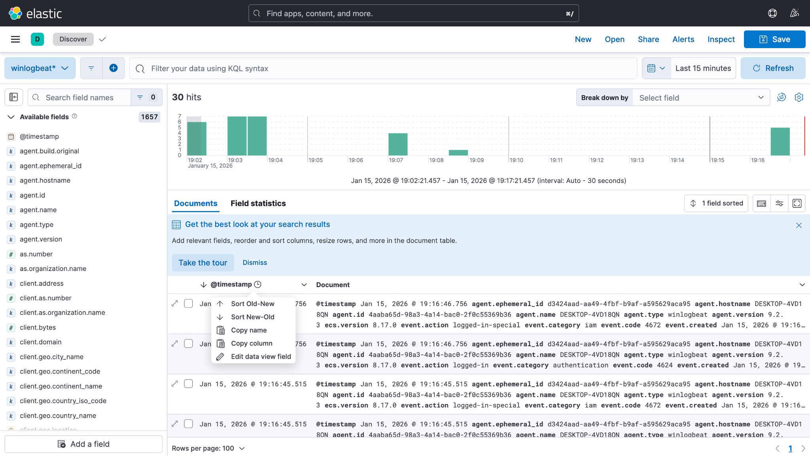
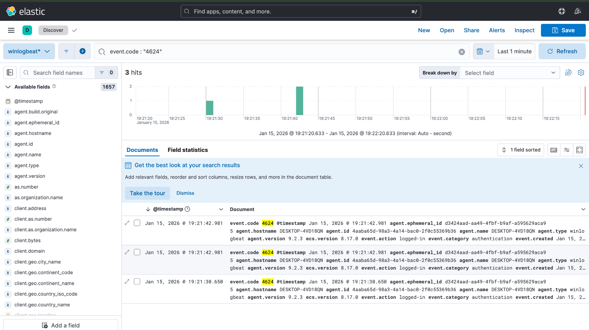
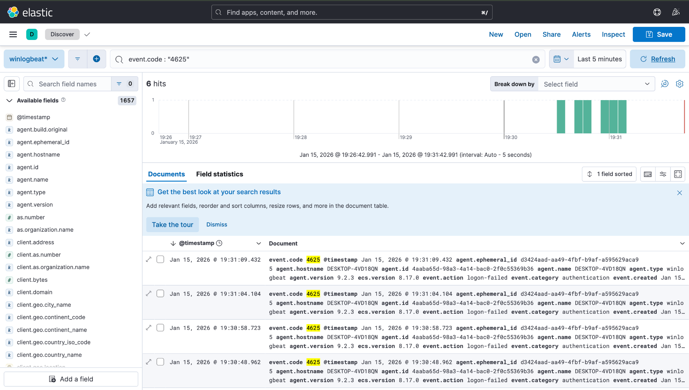
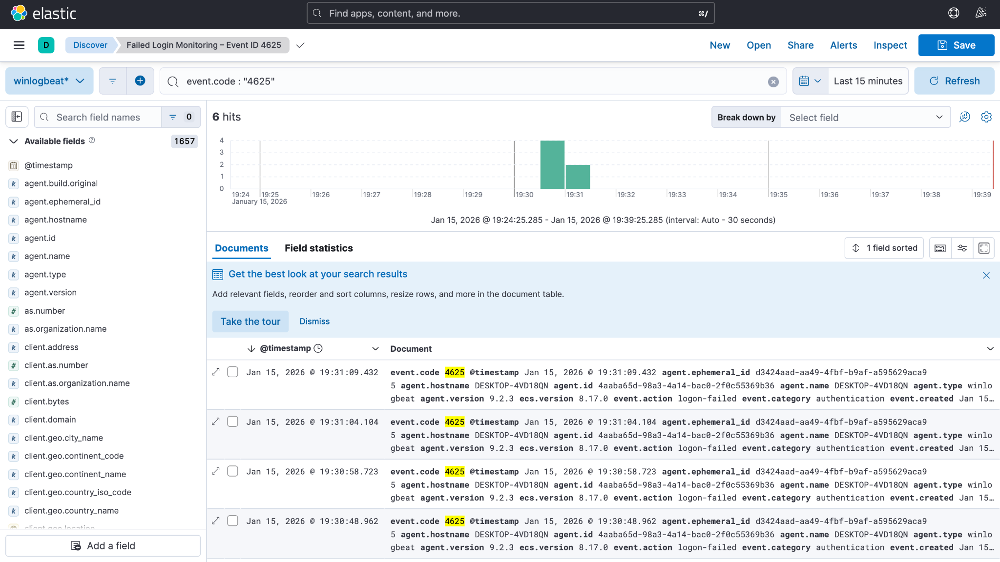
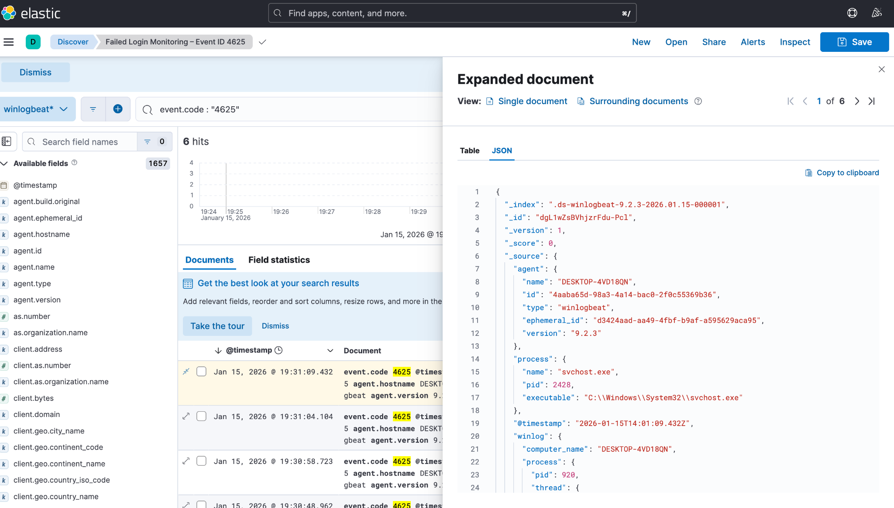

# 🔐 Brute-Force Login Detection using Elastic SIEM

A beginner SOC lab that collects Windows authentication logs into Elastic SIEM, establishes a baseline of normal logins, simulates a brute-force attack, and investigates it following a Tier-1 SOC analyst workflow.


---

## 📌 Objectives

- Understand how a SIEM platform collects and analyses logs
- Forward Windows event logs to Elastic using **Winlogbeat**
- Establish a **baseline** of normal authentication behaviour
- Simulate failed login attempts (brute force)
- Detect and investigate the activity manually in **Kibana**
- Document the incident in a SOC-standard report

---

## 🏗️ Lab Architecture

```
┌────────────────────┐      ┌──────────────────┐      ┌──────────────┐
│  Windows VM        │      │  Elasticsearch   │      │   Kibana     │
│  (log source)      │ ───▶ │  (storage &      │ ───▶ │  (search &   │
│  + Winlogbeat      │      │   indexing)      │      │   analysis)  │
└────────────────────┘      └──────────────────┘      └──────────────┘
```

| Component | Role |
|---|---|
| Windows VM | Generates Security, System and Application event logs |
| Winlogbeat | Ships Windows event logs to Elasticsearch |
| Elasticsearch | Stores and indexes logs |
| Kibana | Search, visualisation and investigation |
| Host | macOS with virtualisation |

---

## 🔎 Detection Queries (KQL)

| Purpose | Query | Windows Event |
|---|---|---|
| Successful logins (baseline) | `event.code:4624` | 4624 – Account logged on |
| Failed logins (detection) | `event.code:4625` | 4625 – Account failed to log on |

All queries are also saved in [`queries/detection-queries.kql`](queries/detection-queries.kql).

---

## 🧪 Walkthrough

### 1. Log collection verified
Winlogbeat was installed on the Windows VM and the `winlogbeat-*` data view was checked in Kibana Discover. Security, System and Application logs were arriving in real time.



### 2. Baseline – normal authentication
A normal successful login was performed and searched with `event.code:4624` to record what "normal" looks like (user, hostname, timestamp).



### 3. Attack simulation
Incorrect passwords were entered multiple times on the Windows login screen to simulate password guessing / brute force.

### 4. Detection – failed logins
Searching `event.code:4625` showed **6 failed login events** for the same account between **19:30:48 and 19:31:09** (about 21 seconds), with no successful login afterwards.



### 5. Saved monitoring view
A saved search **"Failed Login Monitoring – Event ID 4625"** was created so analysts can re-check failed authentications without retyping queries.



### 6. Investigation
Each event was expanded and the username, hostname, timestamp and failure frequency were reviewed.



---

## 📊 Key Findings

| Finding | Detail |
|---|---|
| Pattern | Repeated failed logins against a single user account |
| Time window | ~21 seconds (19:30:48 – 19:31:09 IST, 15 Jan 2026) |
| Outcome | No successful login (4624) after the failures, so the attack was unsuccessful |
| Classification | Brute-force login attempt (simulated) |
| Severity | **Medium** |

---

## 🎯 MITRE ATT&CK Mapping

| Tactic | Technique |
|---|---|
| Credential Access | [T1110 – Brute Force](https://attack.mitre.org/techniques/T1110/) |
| Credential Access | [T1110.001 – Password Guessing](https://attack.mitre.org/techniques/T1110/001/) |

---

## 🛡️ Recommendations (production)

- Enable an account lockout policy after repeated failures
- Create an automated alert for multiple 4625 events in a short window
- Enforce strong password policies and MFA
- Correlate 4625 with a following 4624 to catch *successful* brute force

---

## ⚠️ Limitations

- Automated SIEM alerting was not enabled due to lab constraints
- Detection was done manually through log analysis
- Simplified single-host SOC environment

---

## 📚 Skills Demonstrated

`SIEM` · `Log collection` · `Windows Event IDs` · `KQL` · `Baselining` · `Threat detection` · `Incident investigation` · `SOC documentation`

---

## 📄 Full Documents

- 📘 [Project Documentation (PDF)](docs/project-documentation.pdf)
- 📝 [Incident Report (PDF)](docs/incident-report.pdf)

> All activity was performed in an isolated lab environment for learning purposes.
